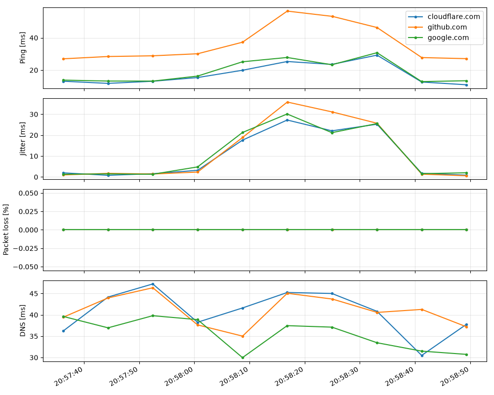

# NETWORK DIAGNOSTIC GEAR

## 1. General description of the idea and how the program works

The program is used to diagnose the network the device is currently connected to. It collects data such as ping, jitter, packet loss and DNS server performance, and saves it to a database file.

It also lets you create a chart from the collected data (when creating the chart, it takes into account all the data in the file at the moment the command is run).

The script supports Unix-based platforms (Linux, MacOS) and Windows.

NOTE: The program saves all measurements until the existing database is deleted.

It has three functions:
* **measure()** : a one-time sample of data from the previously declared internet domains
* **run()** : the main loop that triggers sample collection at a given time interval (runs until Ctrl+C is pressed)
* **plot()** : generates a chart from the data currently collected in the "diag.db" file


## 2. Usage instructions

* Install the required libraries with the command: `pip install -r reqirements.txt`
* The database file does not need to exist beforehand; if it is missing, the program creates it itself
* Before running, look into the code and enter the appropriate values (according to your preferences):
  * **TARGETS[]** : list of domains used as connection points
  * **INTERVAL** : interval in seconds between consecutive measurements
  * **PINGS** : number of pings sent to a domain during a single measurement
  * **DB** : name of the database file with the measurement results
* Run the program using one of two options:
  * `python3 diag.py run` : data collection 
  * `python3 diag.py plot` : chart generation 


## 3. Example use

The program lets you examine given network parameters over a chosen period of time (to restart, you have to delete databse file and run program again). This can be used to analyze when the internet (e.g. at home) performs best and when is the best moment to use it for more demanding tasks. 

It can also help identify anomalies or unusual network behavior, which makes it possible to take further steps, e.g. regarding network security.

## 4. Example chart

Example chart generated with `python3 diag.py plot` from the collected data:



## 5. Example database

The measurements are stored in the `diag.db` file (SQLite), in a single table `m`:

```sql
CREATE TABLE m (ts REAL, host TEXT, ping REAL, jitter REAL, loss REAL, dns REAL);
```

| Column | Description |
|--------|-------------|
| `ts` | measurement timestamp (Unix time) |
| `host` | measured domain |
| `ping` | average ping [ms] |
| `jitter` | jitter [ms] |
| `loss` | packet loss [%] |
| `dns` | DNS query time [ms] |

Example rows (`SELECT * FROM m LIMIT 6;`):

| ts | host | ping | jitter | loss | dns |
|----|------|------|--------|------|-----|
| 1794171456.24031 | google.com | 13.8082 | 1.31283927424495 | 0.0 | 39.6249294281006 |
| 1794171456.23922 | cloudflare.com | 13.1136 | 1.97448662694889 | 0.0 | 36.2222194671631 |
| 1794171456.26197 | github.com | 26.998 | 0.972295634053758 | 0.0 | 39.4511222839355 |
| 1794171464.36224 | google.com | 13.2266 | 1.45906718145533 | 0.0 | 36.956787109375 |
| 1794171464.36126 | cloudflare.com | 11.7794 | 0.792258190238511 | 0.0 | 44.1672801971436 |
| 1794171464.37303 | github.com | 28.4158 | 1.72932858647511 | 0.0 | 43.9670085906982 |
